# QuickBite: CI với GitHub Actions (md05_ss07)

Repo: https://github.com/HoangGiaBaoo/BaoHG_JB-IOC-PTHB260316_MD05_Session07
Tab Actions: https://github.com/HoangGiaBaoo/BaoHG_JB-IOC-PTHB260316_MD05_Session07/actions

```
md05_ss07/
├── .github/workflows/
│   ├── bai1-cart-service-ci.yml         # Bài 1: sửa lỗi cấu hình
│   ├── bai2-user-service-ci.yml         # Bài 2: điền khuyết + upload artifact
│   ├── bai3-payment-service-ci.yml      # Bài 3: 2 job tuần tự test -> build (needs)
│   └── bai4-restaurant-service-ci.yml   # Bài 4: chạy trên self-hosted runner
├── cart-service/          # Spring Boot 3.5 + Gradle 9.7.1, Java 17
├── user-service/          # Java 17
├── payment-service/       # Java 21, JPA + PostgreSQL, 7 unit test (Mockito)
├── restaurant-service/    # Java 17
├── self-hosted-runner/
│   ├── docker-compose.yml # Bài 4: self-hosted runner
│   └── .env.example
└── homework/session_07/exercise_0X/   # ảnh minh chứng từng bài
```

> **Repo này chứa cả 4 bài (monorepo).** GitHub chỉ đọc workflow trong `.github/workflows/` ở gốc repo,
> nên mỗi bài có một file workflow riêng. So với đề, mỗi file chỉ thêm hai thứ:
> `defaults.run.working-directory: <service>` để các lệnh `run` chạy trong thư mục của service, và
> `on.push.paths` để mỗi workflow chỉ chạy khi service của nó thay đổi.

## Link nộp bài

| Bài | Run thành công | Các run lỗi / thử nghiệm |
|-----|----------------|--------------------------|
| 1 | [Cart Service CI #6](https://github.com/HoangGiaBaoo/BaoHG_JB-IOC-PTHB260316_MD05_Session07/actions/runs/42874671906) | [#3 Invalid workflow file](https://github.com/HoangGiaBaoo/BaoHG_JB-IOC-PTHB260316_MD05_Session07/actions/runs/42871799205), [#5 Permission denied](https://github.com/HoangGiaBaoo/BaoHG_JB-IOC-PTHB260316_MD05_Session07/actions/runs/42874398429) |
| 2 | [User Service CI #1](https://github.com/HoangGiaBaoo/BaoHG_JB-IOC-PTHB260316_MD05_Session07/actions/runs/42875518811) (có artifact) | |
| 3 | [Payment Service CI #3](https://github.com/HoangGiaBaoo/BaoHG_JB-IOC-PTHB260316_MD05_Session07/actions/runs/42877016037), [#5](https://github.com/HoangGiaBaoo/BaoHG_JB-IOC-PTHB260316_MD05_Session07/actions/runs/42877726863) | [#1 không checkout](https://github.com/HoangGiaBaoo/BaoHG_JB-IOC-PTHB260316_MD05_Session07/actions/runs/42876124600), [#2 không setup-java](https://github.com/HoangGiaBaoo/BaoHG_JB-IOC-PTHB260316_MD05_Session07/actions/runs/42876631723), [#4 test fail → build bị skip](https://github.com/HoangGiaBaoo/BaoHG_JB-IOC-PTHB260316_MD05_Session07/actions/runs/42877473238) |
| 4 | [Restaurant Service CI #2](https://github.com/HoangGiaBaoo/BaoHG_JB-IOC-PTHB260316_MD05_Session07/actions/runs/42878816320), [#3 (có cache, 31s)](https://github.com/HoangGiaBaoo/BaoHG_JB-IOC-PTHB260316_MD05_Session07/actions/runs/42879891675) | [#1 ENOSPC](https://github.com/HoangGiaBaoo/BaoHG_JB-IOC-PTHB260316_MD05_Session07/actions/runs/42877985478) |

> Artifact của Bài 2 có `retention-days: 3`, nên sẽ hết hạn vào **13/11/2026**. Artifact Bài 3 hết hạn ngày 17/11/2026.

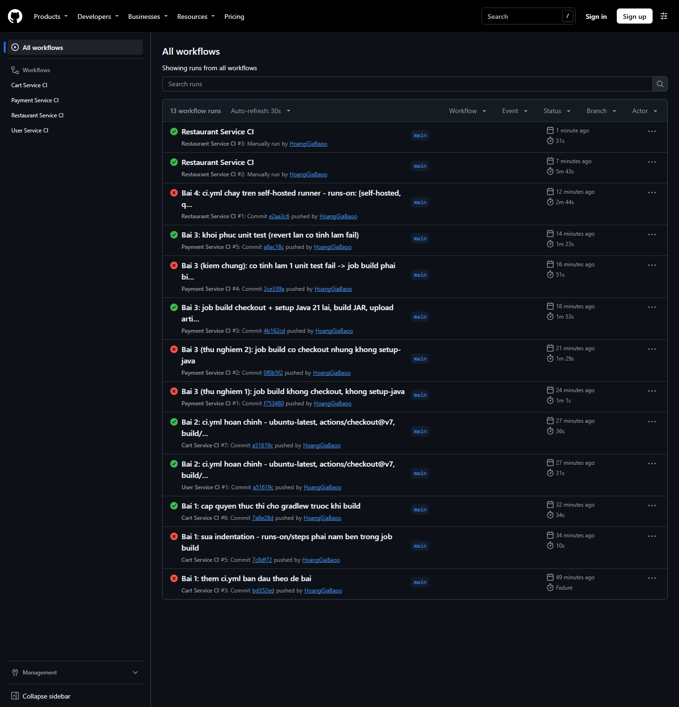

---

## Bài 1: Sửa lỗi cấu hình GitHub Actions cơ bản

Quy trình: push file đúng như đề → đọc log → sửa → push lại. Có 2 lỗi, lần lượt lộ ra sau mỗi lần push.

### Lỗi 1: `Invalid workflow file` (run #3)

```
Invalid workflow file: .github/workflows/bai1-cart-service-ci.yml#L1
(Line: 10, Col: 9): Unexpected value '', (Line: 11, Col: 12): Unexpected value 'ubuntu-latest',
(Line: 13, Col: 3): A sequence was not expected
```

(Số dòng lệch 6 so với đề vì phía trên có thêm khối `defaults`.)

**Phân tích:** `runs-on` và `steps` được thụt lề **ngang hàng** với `build`, nên YAML hiểu như sau:

| Dòng | YAML đọc thành | Lỗi GitHub báo |
|---|---|---|
| `build:` | job `build` có giá trị rỗng (null) | `Unexpected value ''` |
| `runs-on: ubuntu-latest` | một **job** tên `runs-on`, giá trị là chuỗi | `Unexpected value 'ubuntu-latest'` |
| `steps:` + `- uses...` | một **job** tên `steps`, giá trị là list | `A sequence was not expected` |

Workflow sai cấu trúc nên GitHub dừng ngay khi đọc file: không có job nào chạy, thời lượng 0s.

**Sửa:** thụt `runs-on` và `steps` vào trong `build` (và thụt các step vào trong `steps`).

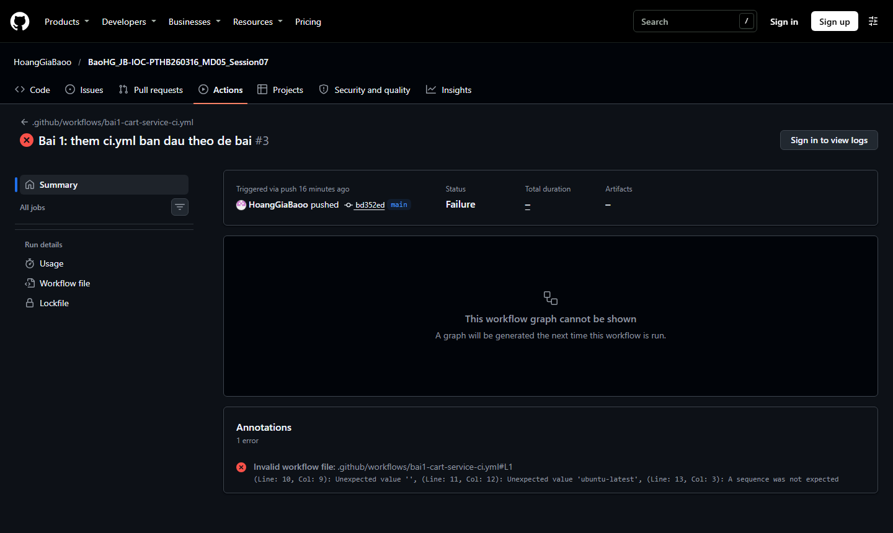

### Lỗi 2: `./gradlew: Permission denied`, exit code 126 (run #5)

Sau khi sửa YAML, job đã chạy: checkout và setup Java đều xanh, nhưng bước build thì fail:

```
/home/runner/work/_temp/8f9ac9f9-....sh: line 1: ./gradlew: Permission denied
##[error]Process completed with exit code 126.
```

**Phân tích:**
- Exit code **126** nghĩa là "tìm thấy file nhưng không có quyền thực thi" (127 mới là "không tìm thấy lệnh").
- `git ls-files -s cart-service/gradlew` cho ra `100644`. File được commit từ Windows (NTFS không có bit `x`,
  `core.filemode=false`) nên Git lưu nó như file thường. Runner Linux checkout ra đúng mode `644`, nên `./gradlew` không chạy được.

**Sửa:** thêm một step cấp quyền trước khi build:

```yaml
      - name: Grant execute permission for gradlew
        run: chmod +x ./gradlew
```

Một cách khác là sửa luôn mode trong Git: `git update-index --chmod=+x cart-service/gradlew` rồi commit.
Bài này chọn `chmod` trong workflow vì nó chạy đúng bất kể file được commit từ máy nào.
(Ngoài ra `.gitattributes` ép `gradlew` dùng LF, nếu không runner sẽ báo `/usr/bin/env: 'sh\r'`.)

### Kết quả (run #6): tất cả các step đều xanh, `BUILD SUCCESSFUL in 25s`

Hai cảnh báo còn lại **không phải lỗi**: `Node.js 20 is deprecated` và `setup-java v4 is deprecated`.
Đó là do đề dùng `@v4`. Mình giữ nguyên `@v4` để đúng phạm vi đề bài, còn các bài sau dùng bản mới nhất.

| | |
|---|---|
| 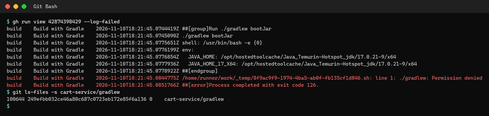 | 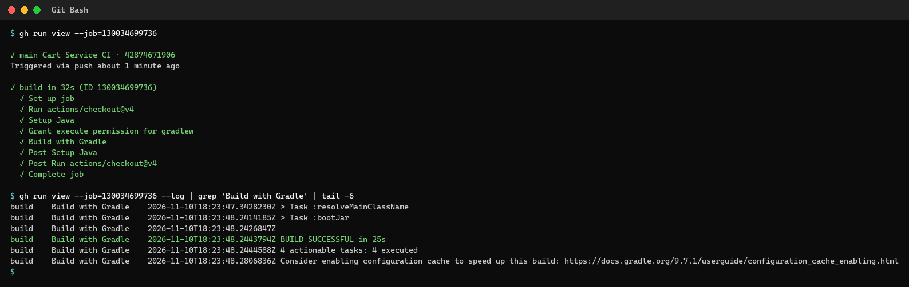 |

---

## Bài 2: Hoàn thiện workflow CI và lưu trữ artifact

| Vị trí | Đáp án | Căn cứ |
|---|---|---|
| `runs-on: [___]` | `ubuntu-latest` | Runner Linux do GitHub cung cấp, miễn phí cho public repo. Đây là lựa chọn phổ biến và ổn định nhất cho Java/Gradle |
| `uses: [___]` | `actions/checkout@v7` | Bản mới nhất trên Marketplace là v7.0.1 (20/07/2026); README chính thức dùng `actions/checkout@v7`, runtime `node24`. `@v4` vẫn chạy được nhưng bị cảnh báo *Node.js 20 is deprecated* (xem log Bài 1) |
| `path: [___]` | `build/libs/*.jar` (trong repo này viết là `user-service/build/libs/*.jar`) | Xem phần kiểm chứng bên dưới |

**Kiểm chứng đường dẫn JAR:** build thử trên máy. Plugin Spring Boot cho task `bootJar` ghi ra
`build/libs/<rootProject.name>-<version>.jar`, tức `build/libs/user-service-0.0.1-SNAPSHOT.jar`.
Task `jar` (sinh `*-plain.jar`) được tắt trong `build.gradle`, nên `*.jar` chỉ khớp đúng 1 file.

Lưu ý: `path` của `upload-artifact` được tính **từ gốc workspace**. `defaults.run.working-directory`
chỉ áp dụng cho các step `run:`, không áp dụng cho `uses:`, nên phải ghi `user-service/...`.

**Kết quả:** run xanh, mục *Artifacts* có `user-service-artifact` (21.3 MB). Mình đã tải về để kiểm tra:
bên trong là `user-service-0.0.1-SNAPSHOT.jar`, có `Start-Class: com.quickbite.userservice.UserServiceApplication` và `Build-Jdk-Spec: 17`.

| | |
|---|---|
| 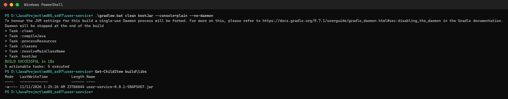 | 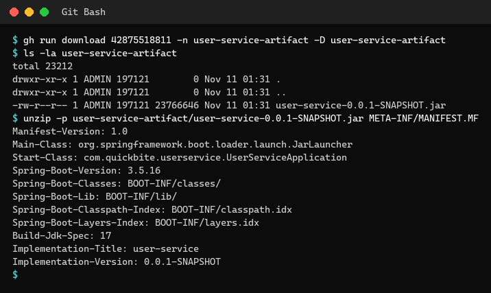 |

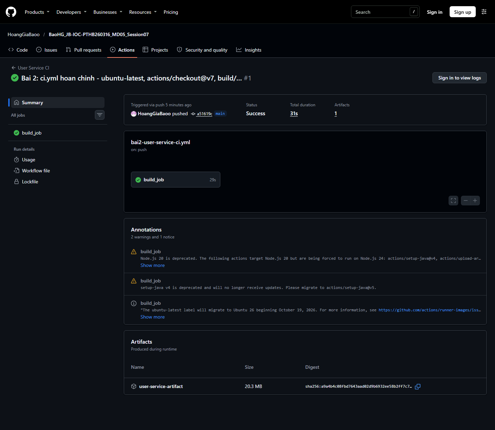

---

## Bài 3: CI tuần tự và Job Isolation

```yaml
jobs:
  test:            # Giai đoạn 1: checkout -> setup Java 21 -> ./gradlew test
  build:
    needs: test    # Giai đoạn 2: chỉ chạy khi test thành công
    steps:         # checkout LẠI -> setup Java 21 LẠI -> chmod + bootJar -> upload build/libs/
```

### Thử nghiệm: job build có thấy những gì job test đã chuẩn bị không?

| Run | Job `build` thiếu gì | Kết quả | Kết luận |
|---|---|---|---|
| #1 | không checkout, không setup-java | `ls -la $GITHUB_WORKSPACE` chỉ thấy `total 8`, gồm `.` và `..`; sau đó `working directory '.../payment-service'. No such file or directory` | Runner của job 2 là **máy ảo mới**, workspace rỗng, nên **phải checkout lại** |
| #2 | có checkout, không setup-java | `java -version` ra `17.0.21` (JDK mặc định của image), sau đó `compileJava FAILED`: **`error: release version 21 not supported`** | JDK 21 mà job 1 đã cài **không đi theo** sang job 2, nên **phải setup-java lại** |
| #3 | đầy đủ | ✓ Unit Test (1m6s) → ✓ Build JAR (43s), có artifact `payment-service-jar` | |

**Job Isolation:** mỗi job được cấp một runner (máy ảo) riêng, sạch hoàn toàn, và bị huỷ khi job xong.
Code đã checkout, JDK đã cài hay file đã build ở job trước đều **không** tự chuyển sang job sau.
`needs` chỉ quy định *thứ tự* và *điều kiện* chạy, không chia sẻ môi trường. Muốn chuyển file giữa các job
thì phải dùng artifact (`upload-artifact` → `download-artifact`) hoặc cache.

| | |
|---|---|
| 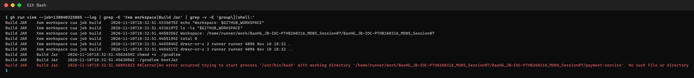 | 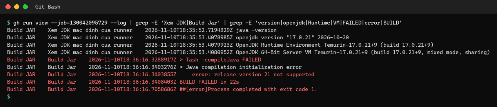 |

### Kiểm chứng `needs`: cố tình làm 1 test fail (run #4)

Mình sửa kỳ vọng phí thẻ 1.5% của 200.000 từ `3000` thành `2000`. Kết quả: `expected: 2000 but was: 3000`,
`7 tests completed, 1 failed`, **Unit Test ✗**, và **Build JAR bị skip** (0s, không chạy step nào).
Sau đó mình revert, và run #5 xanh lại cả 2 job.

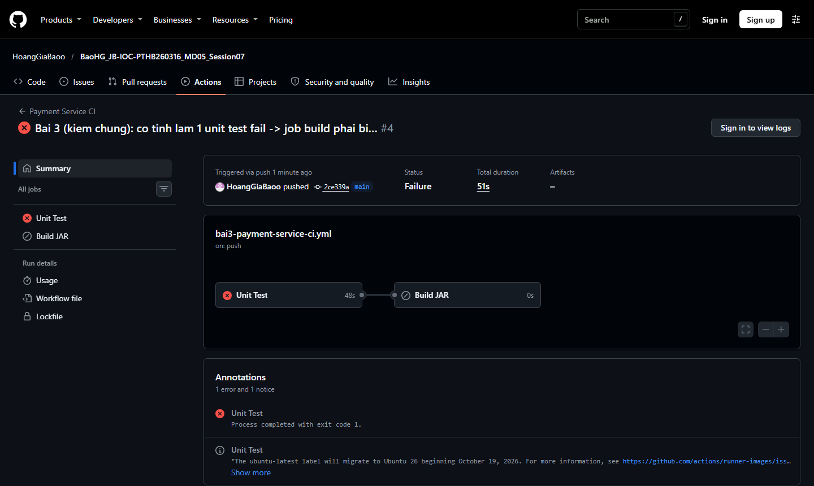

**PostgreSQL:** `application.yml` dùng biến môi trường kèm giá trị fallback (`${DB_HOST:localhost}`, ...).
CI không cần dựng PostgreSQL vì 7 unit test mock `PaymentRepository` bằng Mockito (không khởi động Spring
context), còn `bootJar` chỉ đóng gói chứ không chạy ứng dụng.

---

## Bài 4: Pipeline CI với self-hosted runner

### Nhiệm vụ 1: `self-hosted-runner/docker-compose.yml`

Image `myoung34/github-runner` đóng gói sẵn GitHub Actions runner và Docker CLI.

| Cấu hình | Giá trị | Vì sao cần |
|---|---|---|
| `RUNNER_SCOPE` + `REPO_URL` | `repo`, URL của repo | Cho runner biết nó **thuộc repo nào** |
| `RUNNER_TOKEN` *hoặc* `ACCESS_TOKEN` | registration token (1 giờ) / PAT scope `repo` | **Xác thực** khi đăng ký. Token để trong `.env` (đã gitignore), không commit |
| `RUNNER_NAME`, `LABELS` | `quickbite-runner-01`, `quickbite` | Định danh runner. Pipeline gọi tới bằng nhãn |
| `RUNNER_WORKDIR` | `${RUNNER_WORK_ROOT}/work` | Thư mục `_work`: nơi checkout code và build |
| volume `/var/run/docker.sock:/var/run/docker.sock` | | Lệnh `docker ...` trong job nói chuyện với **Docker daemon của host** (Docker-outside-of-Docker) |
| volume `${RUNNER_WORK_ROOT}:${RUNNER_WORK_ROOT}` | mặc định `/tmp/runner` | Chỗ lưu tạm thư mục làm việc, mount ra host. **Host và container phải cùng đường dẫn**, vì khi job chạy `docker run -v $PWD:...` thì daemon của host mới là bên đi tìm đường dẫn đó |

```powershell
cd self-hosted-runner
copy .env.example .env      # điền RUNNER_TOKEN (Settings > Actions > Runners > New self-hosted runner)
docker compose up -d
docker compose logs -f      # √ Connected to GitHub ... Listening for Jobs
```

Settings > Actions > Runners sẽ hiện `quickbite-runner-01` ở trạng thái **Idle**. API trả về `"status":"online","busy":false`,
với các nhãn `self-hosted, Linux, X64, quickbite`.

### Nhiệm vụ 2: `.github/workflows/bai4-restaurant-service-ci.yml`

```yaml
    runs-on: [self-hosted, quickbite]   # runner phải có ĐỦ cả hai nhãn
```

Các step: setup Java 17 (`setup-java@v6`), `chmod +x` rồi `./gradlew bootJar`. Workflow có thêm 2 step để chứng minh:
in tên runner, và chạy `docker ps` qua docker.sock. Bước `docker ps` liệt kê được các container của host, trong đó có cả chính container `quickbite-runner`.

### Sự cố gặp phải: `ENOSPC: no space left on device` (run #1)

Job đã được giao tới runner, nhưng `setup-java` fail khi giải nén JDK. Mình kiểm tra trong container:

```
tmpfs  392M  24M  368M  7% /tmp/runner
tmpfs on /tmp/runner type tmpfs (rw,nosuid,nodev,noexec,...)
```

Trên **Docker Desktop (Windows)**, đường dẫn host `/tmp/runner` nằm trong VM Linux của Docker Desktop,
và ở đó `/tmp` là **tmpfs chỉ 392 MB, lại mount `noexec`**. Không đủ chỗ cho JDK, và kể cả có đủ chỗ
cũng không chạy được file thực thi trong đó. Mình thử các đường dẫn khác thì thấy `/var/lib/...` nằm trên disk dữ liệu (`/dev/sdd`, ext4, cho phép exec).

**Sửa:** tham số hoá `RUNNER_WORK_ROOT`. Mặc định vẫn là `/tmp/runner` (đúng cho server Linux), còn trên
Docker Desktop thì đặt `RUNNER_WORK_ROOT=/var/lib/quickbite-runner` trong `.env`.

### Kết quả

- Run #2 xanh. Log có `Runner name: 'quickbite-runner-01'` và `Machine name: 'ebe07a5057e7'` (chính là container
  runner), workspace nằm ở `/var/lib/quickbite-runner/work/...`. Job **không** chạy trên runner của GitHub.
- Run #3 (chạy lại) chỉ mất **31s so với 5m43s**: `Resolved Java 17.0.21+9 from tool-cache`, Gradle
  `BUILD SUCCESSFUL in 8s` so với `2m 37s`. Runner riêng giữ lại JDK và cache Gradle giữa các lần chạy. Đây chính là lý do QuickBite đầu tư server riêng.

| | |
|---|---|
| 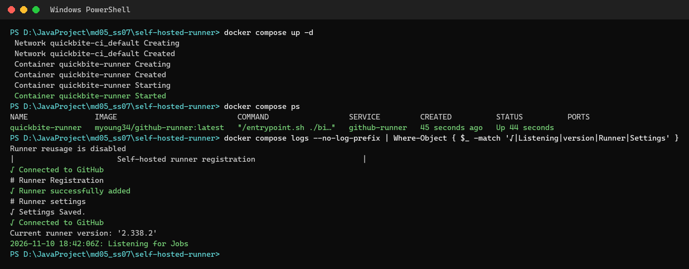 | 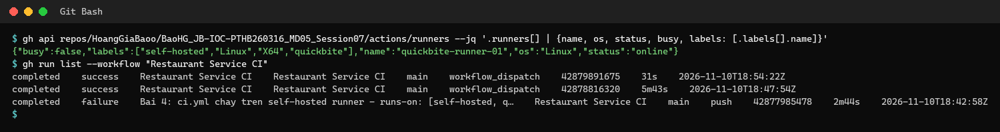 |
| 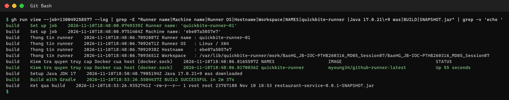 | 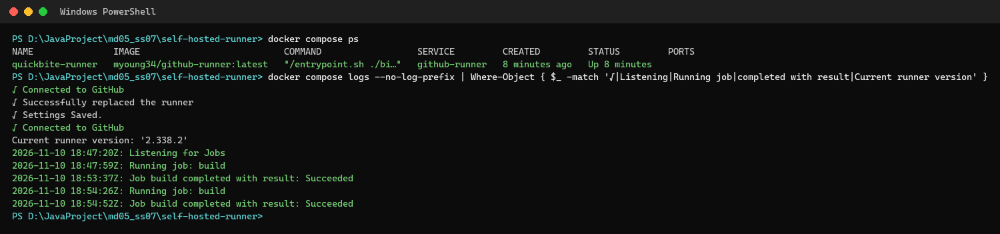 |

> **Bảo mật:** GitHub khuyến cáo không gắn self-hosted runner vào **public** repo, vì người ngoài có thể
> tạo pull request để chạy code trên máy của mình. Workflow ở đây chỉ chạy khi `push`/`workflow_dispatch`.
> Chấm bài xong nên tắt runner: `docker compose down`.

---

## Ghi chú

- Ảnh trang Actions trong `homework/` được chụp bằng Chrome headless ở chế độ chưa đăng nhập, nên có nút "Sign in to view logs".
  Ảnh terminal được dựng lại từ output thật của `gh` CLI, `git` và `docker compose`.
- Không cần cài Gradle: mỗi service có sẵn Gradle Wrapper (`gradlew`, Gradle 9.7.1).
